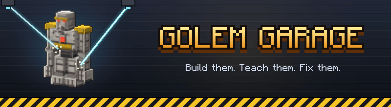

# Golem Garage

A NeoForge mod for Minecraft 1.21.1 by xTrip.

Build your own golems out of parts and put them to work. Every golem has a head, torso, arms, legs and a core,
each a shape made from a material. Teach them jobs with simple rules, repair them in a Garage you build
yourself, and dress up their tiny cousins, the Cubs.

- Player guide: [docs/GUIDE.md](docs/GUIDE.md)
- Build: `gradle build` with Gradle 8.14 and Java 21 (the jar is in `build/libs`)
- Generated content (textures, models, recipes, language file, manual, guide): `python3 tools/golemgen/gen.py`

All Rights Reserved.
